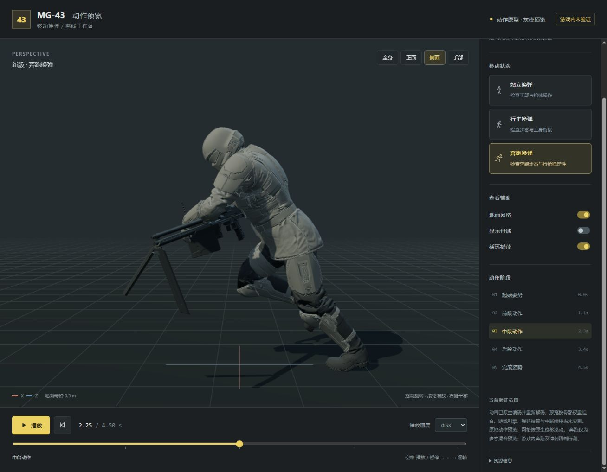

# 机枪移动动作 · Helldivers 2

MG-43 自然移动换弹，以及可独立开关的 M-1000 移动射击。

**当前版本：v0.2.1，修复版待实机验证。** v0.2.0 曾在游戏内成功加载，但数据定位失败，两个移动功能没有启用。v0.2.1 修订了定位逻辑；离线和真实 Windows 自有内存测试已通过，尚不能据此确认游戏内效果。

## 下载与安装

从 [Releases](https://github.com/PJ1059/hd2-machinegun-mobile-actions/releases) 下载 `Machinegun-Mobile-Actions-v0.2.1.zip`。GitHub 自动生成的源码 ZIP 不是安装包。

1. 在 HD2Arsenal 中导入安装包，更新旧版时沿用同一 MOD。
2. 在模组选项中勾选需要的功能，并启用 MOD 总开关。
3. 部署后重新启动游戏。

需要另行安装 [Bingus Shared Loader](https://github.com/CowboyBingus/BingusSharedLoader)，要求 API 1；本机验证环境使用 v19。运行时不依赖 HD2Runtime。

| 独立选项 | 改动 |
| --- | --- |
| MG-43：自然移动换弹 | 接入直立普通/快速换弹动画，允许移动换弹，保留原版趴姿换弹引用。 |
| M-1000：允许移动射击 | 解除射击时必须站定的限制，保持原射速、伤害、起转时间和射击事件。 |

两个选项可分别或同时勾选；全部取消时本包不部署补丁。初始勾选状态由 Arsenal 的全局设置决定。已核对 Arsenal 0.36.2 的原生选项与补丁重编号逻辑。

当前匹配 **Steam build 25480438**。插件在核对游戏文件指纹、数据组件及目标记录后才修改字段。

## v0.2.1 定位修复

旧版要求单个内存区域的尺寸恰好等于完整数据表分配大小，并只扫描一次；查询失败还会被统一报成 `expected exactly one current entity allocation`。

新版支持同一分配区被保护设置分段、分配区较大和数据表稍晚就绪的情况；只接受完整核实的唯一目标。最多扫描五次，分别记录扫描次数、表头数、有效候选数与具体查询错误。旧日志没有候选数量，因此尚未确认原实机失败属于哪一分支。

验证结果：

- 两插件合计 14 项定位回归，以及 4 项真实 Win32 自有分配区查询、读写、保护恢复与字节还原测试通过。
- 两插件各 10 项记录/写入检查、5 项真实 Bingus core 共存检查通过。
- 两条新动画独立解码、原生资源依赖、四组选项组合与最终 ZIP 读回通过。

详见 [定位修复记录](reference/locator-bug-0.2.1.md) 和 [随包验证报告](verification/v0.2.1/validation-report.json)。上述测试没有访问游戏进程；游戏加载、实际步态、移动速度、中断续接与联机表现仍待验证。

## 离线动作预览

预览可旋转视角、逐帧查看，支持原版/新版对照和站立、行走、奔跑三种状态。奔跑使用原生连续 sprint 步态，地面按原生位移滚动。

仓库不包含原版角色、护甲、武器、动画导出文件和完整三维预览资产。作者本机已生成资产时，可运行 `npm install`、`npm start`，打开 `http://127.0.0.1:5177/`；也可使用 `打开预览.cmd`。仅克隆源码不会生成游戏资产。

## 源码与开发范围

`src/addon.lua` 为两个独立插件共用的模板，`tools/` 包含原生动画、打包和验证脚本。开发脚本目前依赖作者现有的 HD2Runtime/Filediver 工作区布局、版本定义和本地游戏文件，**不是独立构建环境**；第三方工具、定义文件和游戏解包数据未随仓库发布。

技术记录：[原生动画](reference/native-animation-notes.md)、[M-1000 字段与动画权重](reference/m1000-movement.md)、[Arsenal 独立选项](reference/arsenal-options.md)、[原生步态](reference/locomotion.md)。来源与第三方许可见 [THIRD_PARTY.md](THIRD_PARTY.md)。
